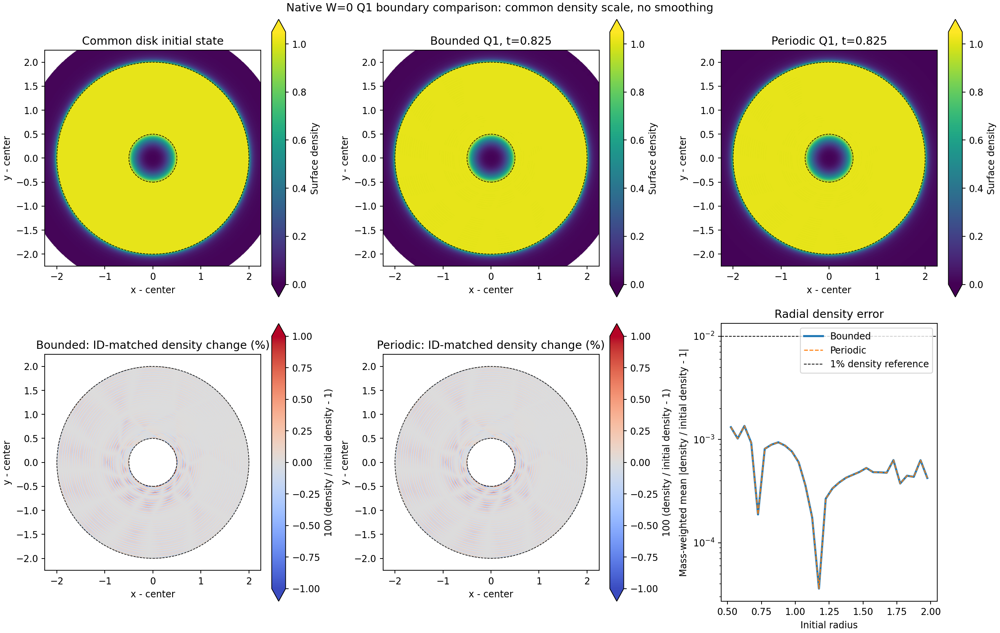

# First bounded Q1 checkpoint: exact t=.825

Job 439333 saved `khout.001218.dat`, SHA256 `e5fa9be0d2f596e1940afb08f9c03afcf2e1a19801ee31990842e808e6c9f6c1`, at exact t=.825. All 28 native checkpoint checks passed. The same allocation read that accepted state and continued toward t=2.5; it did not regenerate t=0.

| Initial-radius population / measure | Previous periodic Q1 | Bounded Q1 |
| --- | ---: | ---: |
| Disk mean absolute density change | 5.2352008e-4 | 5.2352024e-4 |
| Disk mean absolute log-entropy change | 1.5331780e-4 | 8.4850687e-6 |
| Disk signed log-entropy change | -8.45393e-6 | -1.1081983e-6 |
| Disk mean orbit-position error | 1.11215e-8 | 1.1172838e-8 |
| Core r<.1 mean orbit-position error | 3.3003797e-5 | 3.2786253e-4 |
| Core r<.1 mean absolute log-entropy change | 2.9494122e-5 | 8.0628082e-4 |
| Core r<.1 mean absolute density change | 7.2413303e-3 | 1.0464453e-2 |
| Total relative energy change | -3.1165782e-11 | -3.5420803e-7 |

The core/disk records are initially identical, but the exterior and entire-domain energy normalization differ. Bounded evolution used 1,217 accepted intervals, versus the previous endpoint step label 10,856; removal of the outer CFL restriction changes timestep accuracy and roundoff accumulation. The disk entropy difference is therefore not isolated evidence for boundary-induced heating reduction. Signed disk entropy is negative in both cases. The nearly identical disk density/orbit errors are the stronger early comparison.

`DENSITY_T0825.json` pins all four initial/final inputs, common density limits [0,1.05] and common relative-density-change limits [-1%,1%]. Raster pixels use the actual W0 nearest-generator cells, with no smoothing; relative-change panels select original disk IDs. The two radial curves overlap almost exactly and are distinguished by solid/dashed lines. This is a same-time boundary comparison, not a t=600 GIZMO comparison.

## Independent core attribution control

`CORE_RK4_CONTROL_T0825.json` independently integrates only the 134 core gravity ODEs using the actual full-precision accepted timestep sequence. It takes less than one second on the compute host and changes no native simulation. The native mean orbit error is 3.27863e-4; gravity-only RK4 gives 2.98802e-4 at the same steps, 9.57057e-6 at half steps, and 3.06563e-7 at quarter steps.

The native-minus-gravity-control position residual is 3.30791e-5, or 10.09% of the native orbit error. The predeclared strong hypothesis requiring less than 5% residual **failed** and remains failed in the receipt. The results identify a large timestep-sensitive component, but do not attribute all native position error, entropy or density changes to it. No tolerance was adjusted and no gas evolution was replayed.

## Actual wall angular impulse

`ANGULAR_BUDGET_T0825.json` separately reports physical wall impulse and the integrator balance residual. There were no collisions. Cumulative wall angular impulse is 3.53e-15 of initial disk angular momentum; actual disk angular-momentum relative change is -9.40e-13. Total fluid angular change is -5.27e-9, and the budget matches the logged integration residual to 4.08e-21. This checks that wall torque is negligible at this early checkpoint; it does not prove isolation at later times or equivalence to the paper's boundary conditions.

Astra's focused review recommends preserving the current chain through the unchanged t=3,6.5,10 gates. If the core/energy trend remains important after t=10, one accepted-restart timestep-sensitivity comparison takes priority over broad long-time expansion. Otherwise, a boundary-radius/shape pair is the next unresolved physics check. Weights and intrinsic spin remain conditional on evidence; they were not enabled in this run.

The separately tested [constant-configuration cache](../KEPLER_NATIVE_CONST_CONFIG_CACHE_2026-10-29/README.md) preserves stored states and printed ledgers and improves the measured short-window native speed, but it is not installed in this running physical chain. GIZMO t=120/600 and the radius-qualified longest-orbit target remain pending.
