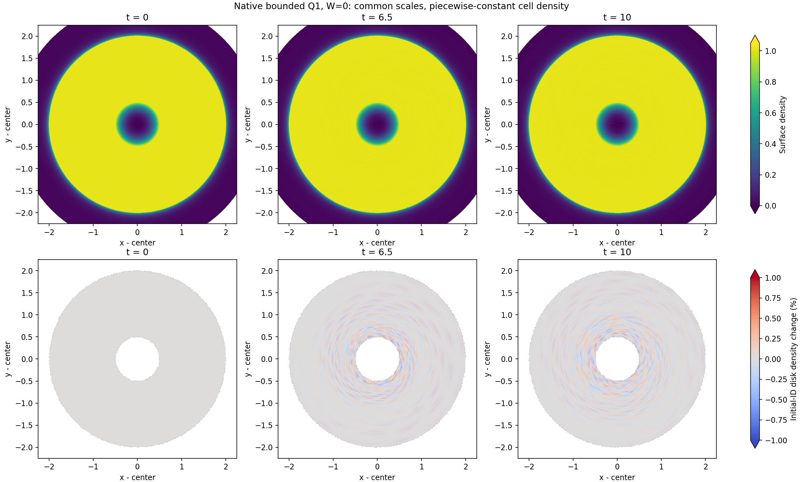

# Exact t=10: disk checks pass while the inner core remains inaccurate

H200 job 439333 completed the planned native bounded Q1 chain through exact t=10. All 28 original disk/state checks passed. The complete accepted checkpoint `khout.020790.dat` has SHA256 `58afbe3ab219ddef0b8dbb9b032789236ec01815bcf80457a5d73e6b90bd6c28`. The 48,680 initial disk IDs and all 90,352 masses remain fixed, W=0, with no reported floor or dual-energy injection.

The disk mean absolute density change is 0.0574304%, mean absolute log-entropy change 9.30371e-5, signed log-entropy change -6.26146e-5, mean circular position error 1.05366e-6, and angular-momentum relative change -1.57110e-12. Total energy change relative to the original IC is -2.22876e-6. Signed entropy is negative; its absolute discrepancy is not a positive-heating measurement.

**This is a disk-gate pass, not whole-domain or GIZMO long-time validation.** The original r0<.1 core density mean absolute change is 56.3175%, and its mean absolute circular position error is 0.0506955. In the adjacent r0=.1–.5 region, the native density relative to the circular-site geometry reference has a 76.86% cell p99 and 463.5% maximum despite the 0.2823% mass mean. Percentiles count cells, not mass. The damaged core is not promoted to a t120/t600 production branch.

Upper panels use common surface-density limits [0,1.05], and lower panels use [-1%,1%] relative to each original disk ID. Colors saturate outside these limits. White lower-panel regions exclude non-disk IDs and are not vacuum measurements. The full-disk view does not resolve the small low-density core, whose error is quantified above.

## Independent geometry and wall angular budget

Two all-site independent Voronoi reconstructions clipped to the same polygon agree with native cell volumes to maximum relative error 5.94980e-8. The circular-site kinematic reference has disk mean absolute density change 0.0574247%, close to the native 0.0574304%. Native density versus circular geometry differs by 0.0009743% in disk mass mean. This is a geometric reference, not an exact finite-cell fluid solution or proof of entropy accuracy.

For r0<.1, native density differs from circular geometry by 56.4117% in mass mean, whereas the circular reference alone changes by 0.6118%. The large core error cannot be explained as saved-cell-volume arithmetic error alone. Cumulative physical wall angular impulse / initial disk angular momentum is -6.12151e-15, with zero wall collisions and a passing independent angular budget. Small wall torque does not rule out radial boundary influence or prove boundary equivalence with GIZMO.

## Native H200 timing and live follow-up

The dependent H200 job 439375 actually started from the verified exact t10 checkpoint. Its A/B/B/A cache test passed full stored-record/footer and printed numeric-ledger parity, with median per-step speedup 1.9743x for this short late-state H200 interval. `H200_ABBA_T10.json` preserves the evidence. This qualifies that candidate only under its tested process-constant environment and hardware/physics scope; it does not establish all later states or MPI scaling. The separate eta=.06 Ada test exposed a tiny printed potential-ledger mismatch for this candidate, so the currently running capped branch uses baseline v2.

The H200 job then began three t10→10.1 controls from the same inherited checkpoint with original, half and quarter timestep ceilings. Their purpose is incremental timestep sensitivity and cost, not repair of the inherited core. The independent Ada eta=.06 native comparison is running from the accepted t=.001528 startup through .4125 and .825 with the original fixed-mass W0 physics and preregistered core checks. If it succeeds, comparison with the already saved coarse .825 state tests whether a smaller orbital timestep prevents early core damage. Neither short control or t10 alone establishes GIZMO t120/t600, boundary convergence, shock accuracy, or the radius-qualified long-orbit goal.
