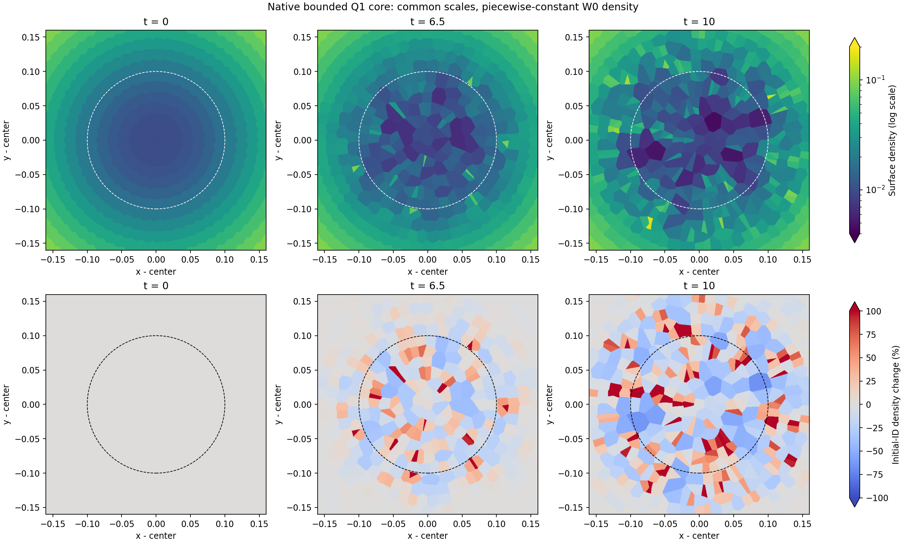

# Exact t=10: disk checks pass while the inner core remains inaccurate

H200 job 439333 completed the planned native bounded Q1 chain through exact t=10. All 28 original disk/state checks passed. The complete accepted checkpoint `khout.020790.dat` has SHA256 `58afbe3ab219ddef0b8dbb9b032789236ec01815bcf80457a5d73e6b90bd6c28`. The 48,680 initial disk IDs and all 90,352 masses remain fixed, W=0, with no reported floor or dual-energy injection.

The disk mean absolute density change is 0.0574304%, mean absolute log-entropy change 9.30371e-5, signed log-entropy change -6.26146e-5, mean circular position error 1.05366e-6, and angular-momentum relative change -1.57110e-12. Total energy change relative to the original IC is -2.22876e-6. Signed entropy is negative; its absolute discrepancy is not a positive-heating measurement.

**This is a disk-gate pass, not whole-domain or GIZMO long-time validation.** The original r0<.1 core density mean absolute change is 56.3175%, and its mean absolute circular position error is 0.0506955. In the adjacent r0=.1–.5 region, the native density relative to the circular-site geometry reference has a 76.86% cell p99 and 463.5% maximum despite the 0.2823% mass mean. Percentiles count cells, not mass. The damaged core is not promoted to a t120/t600 production branch.

Upper panels use common surface-density limits [0,1.05], and lower panels use [-1%,1%] relative to each original disk ID. Colors saturate outside these limits. White lower-panel regions exclude non-disk IDs and are not vacuum measurements. The full-disk view does not resolve the small low-density core, whose error is quantified above.

The core can be inspected separately at higher density contrast:

Upper panels share the same logarithmic density scale [0.004,0.2]. Lower panels share [-100%,100%] for each initial ID; colors saturate beyond these values. The dashed circle is current radius 0.1.

## Independent geometry and wall angular budget

Two all-site independent Voronoi reconstructions clipped to the same polygon agree with native cell volumes to maximum relative error 5.94980e-8. The circular-site kinematic reference has disk mean absolute density change 0.0574247%, close to the native 0.0574304%. Native density versus circular geometry differs by 0.0009743% in disk mass mean. This is a geometric reference, not an exact finite-cell fluid solution or proof of entropy accuracy.

For r0<.1, native density differs from circular geometry by 56.4117% in mass mean, whereas the circular reference alone changes by 0.6118%. The large core error cannot be explained as saved-cell-volume arithmetic error alone. Cumulative physical wall angular impulse / initial disk angular momentum is -6.12151e-15, with zero wall collisions and a passing independent angular budget. Small wall torque does not rule out radial boundary influence or prove boundary equivalence with GIZMO.

## Pressure and thermal rates

The separate [native RHS and independent population analysis](RHS_T10_README.md) finds core mass-mean abs(Udot)/(U Omega) 0.236 and cell p99 0.889, versus disk mass mean 0.00349. These are instantaneous compressional-work rates in an already inaccurate core, not entropy generation. Pressure-force acceleration can be small relative to gravity while thermal work remains fast; both time scales must be converged in any proposed split integrator.

## Native H200 timing and live follow-up

The dependent H200 job 439375 actually started from the verified exact t10 checkpoint. Its A/B/B/A cache test passed full stored-record/footer and printed numeric-ledger parity, with median per-step speedup 1.9743x for this short late-state H200 interval. `H200_ABBA_T10.json` preserves the evidence. This qualifies that candidate only under its tested process-constant environment and hardware/physics scope; it does not establish all later states or MPI scaling. The separate eta=.06 Ada test exposed a tiny printed potential-ledger mismatch for that candidate; the capped comparison below therefore uses baseline v2.

### Ada native RK4 gravity-timestep cap, eta=0.06, through t=0.825

The cap comparison resumed the exact accepted t=0.0015284035789018555 checkpoint (step 22), reached t=0.4125 at step 5400, and continued from that saved checkpoint to t=0.825 at step 10798. Both stages exited 0 and passed all 29 original bounded-Q1 checks. Their measured runtimes were 4306.581 s and 4209.925 s. No t=0 replay was performed. The endpoint files and audits are preserved under `/gpfs/kjhan/LagForce/Kepler_Q1_BoundedGlobal_20261029/gravity_cap_preflight_v1/native_eta006_ada_followon_20261030/`.

The matched no-cap reference is the original-IC H200 checkpoint `chain_h200_v2/to0p825/khout.001218.dat`. It uses the same baseline-v2 executable SHA256 `f26816122df101ea71f72b4f3fb9233e965d06784ed94e88cfb46245fa251444`, identical `params.dat` SHA256 `2898a04490002a24b766f0525426bfb41911e5733f54997b60673a5b5b69ef43`, the same initial IDs and physical fields, and `EUNHA_KEPLER_DTETA=0`; the Ada continuation differs in the gravity timestep ceiling (`eta=0.06`). The comparison is therefore controlled for code and IC, while hardware differs.

At t=0.825, the mass-weighted disk density error is essentially identical: 0.0523520% for eta=0.06 and 0.0523520% for the no-cap reference. The disk absolute log-entropy error is 0.0153777% versus 0.000848507%, respectively; both remain below the gate, but the capped run's absolute entropy scatter is about 18 times larger. In the r0<0.1 core, eta=0.06 lowers the density error from 1.04645% to 0.724128%, lowers the absolute log-entropy error from 0.0806281% to 0.00331691% (about 24 times), and lowers the mean absolute circular-position error from 3.27863e-4 to 3.30001e-5 (about 10 times). The total-energy relative drift is -3.17059e-11 for eta=0.06 and -3.54208e-7 for the no-cap reference; angular-momentum drift remains about 1e-12 in both.

This is evidence that a smaller gravitational timestep improves early core orbit and entropy accuracy, but does not improve the disk density error. It is not a production solution: the endpoint counter is 10798 versus 1218, about 8.9 times as many steps, and the disk entropy scatter increases. The test reaches only t=0.825 and cannot establish the known t>6 failure or GIZMO's long-time result.

The comparison target is Hopkins (2015), [GIZMO, §4.2.4 and Fig. 7](https://arxiv.org/abs/1409.7395): the MFM disk is shown at t=600, with the inner r≈0.5 disk completing more than 250 orbits. The paper discusses vacuum boundaries for particle methods. This Q1 branch uses a bounded fixed polygon, so matching the density image does not by itself establish boundary-condition equivalence or a direct reproduction of that long-time test.

The H200 job then began three t10→10.1 controls from the same inherited checkpoint with original, half and quarter timestep ceilings. Their purpose is incremental timestep sensitivity and cost, not repair of the inherited core. Neither these short controls nor t10 alone establishes GIZMO t120/t600, boundary convergence, shock accuracy, or the radius-qualified long-orbit goal.
