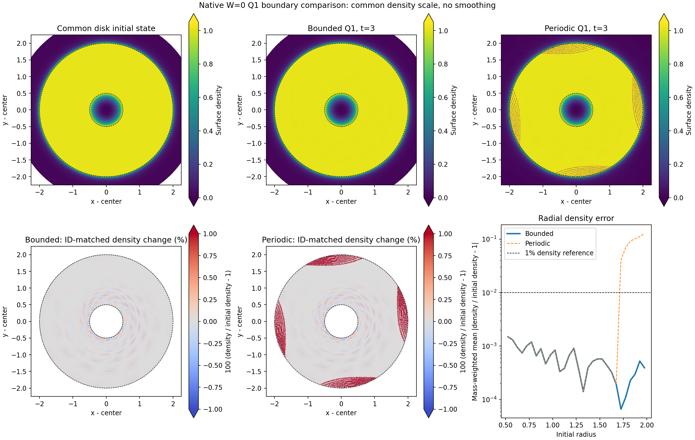

# Exact t=3: original disk-density failure removed in the bounded experiment

H200 job 439333 saved the complete native checkpoint `khout.004487.dat` at exact t=3, SHA256 `ce79522f497a7fa0b21dc73b41e86e4010c19c110a1d347f8f1a2c35ba89c117`. All 28 checkpoint checks passed, including the original 15 physics thresholds and 9 radial thresholds. The same allocation immediately continued toward t=6.5 from this accepted state. `RESTART_FROM_T3.json` records the actual predecessor/hash; no t=0 regeneration occurred.

| Same-time measure | Previous periodic Q1 | Bounded Q1 |
| --- | ---: | ---: |
| r0=1–2 mean absolute density change | 3.4208588% | 0.0396006% |
| Full disk mean absolute density change | 2.7537332% | 0.0497882% |
| r0=1–2 mean orbit-position error | 1.5901653e-7 | 1.3968316e-7 |
| r0=1–2 mean absolute log-entropy change | 4.2257192e-4 | 3.0692987e-5 |
| Total energy relative change | -2.8071288e-8 | -1.2365682e-6 |
| Core r0<.1 mean density change | 5.0255285% | 4.9573467% |
| Core r0<.1 mean orbit-position error | 8.8439879e-4 | 1.2981474e-3 |

The originally failed r0=1–2 density gate was **1%** and is unchanged. All 48,680 scientific-disk initial IDs/positions/velocities/masses/thermal energies were preserved. The exterior initialization, domain boundary and resulting accepted timesteps differ. This is evidence that the new boundary/exterior experiment removes the old t3 failure, not evidence that a general pressure solver became more accurate in every region. It is also consistent with the earlier saved-state diagnosis that exterior generators corrupted disk support. The nearly equal disk orbit errors are important alongside the large density difference.

Both density panels use the same [0,1.05] scale; both ID-matched disk density-change panels use [-1%,1%]. The relative panels saturate outside that range and exclude non-disk initial IDs; white gaps there are not vacuum measurements. Full-density panels include all native cells. The scalar table and radial profile quantify the differences beyond the display limits.

At t3 the disk mean absolute log-entropy change is 2.63466e-5, signed change -1.11546e-5, orbit-position error 1.55980e-7 and angular-momentum relative change -1.83240e-12. Floor/dual/entropy-floor injections are exactly zero. No wall impacts occurred. Cumulative physical wall angular impulse is -5.91776e-15 of the initial disk angular momentum. Thus the early disk preservation is not explained by a large measured wall torque. The separate cumulative angular budget passed; small corrected residual alone would not establish an isolated disk.

## Remaining accuracy and boundary limits

Core errors were already present in the older periodic t3 result, and the bounded core position/entropy accuracy is worse. The .825 gravity-only control identified a large timestep-sensitive component but failed the stronger 95%-attribution criterion. Timestep sensitivity and the residual spatial/hydrodynamic error must remain separate questions. Passing the disk gates is not a cure for the core. Keep the planned t6.5/t10 data, then resolve the core accuracy before an unqualified t120/t600 expansion.

`POLYGON_FLOW_COMPATIBILITY.json` adds an analytic boundary caveat. Pure circular velocity is not exactly tangent to a flat facet: its normal component has a vertex-limit magnitude `v_phi(R)*sin(pi/N)`. At R=2.75,N=1024, the radial shape gap is only 1.29e-5, but the reference normal velocity reaches 0.001850, about 0.155 of the prescribed local sound speed. This is a continuum-reference compatibility calculation, not a measured native flux or proof of an acoustic disturbance. It explains why a small geometric shape error alone cannot establish a harmless long-time wall; radius/shape dependence remains required.

The running v2 executable, W0/fixed masses, Re=infinity and no-steering policy remain unchanged. The separate 1.51x configuration-cache candidate has passed full-state/printed-ledger parity and actual late collision/rollback checks, but was not swapped into this chain. No intrinsic spin is enabled. Native t>6 stability, core accuracy, boundary convergence, MPI scaling and the GIZMO long-time targets remain unproven.
