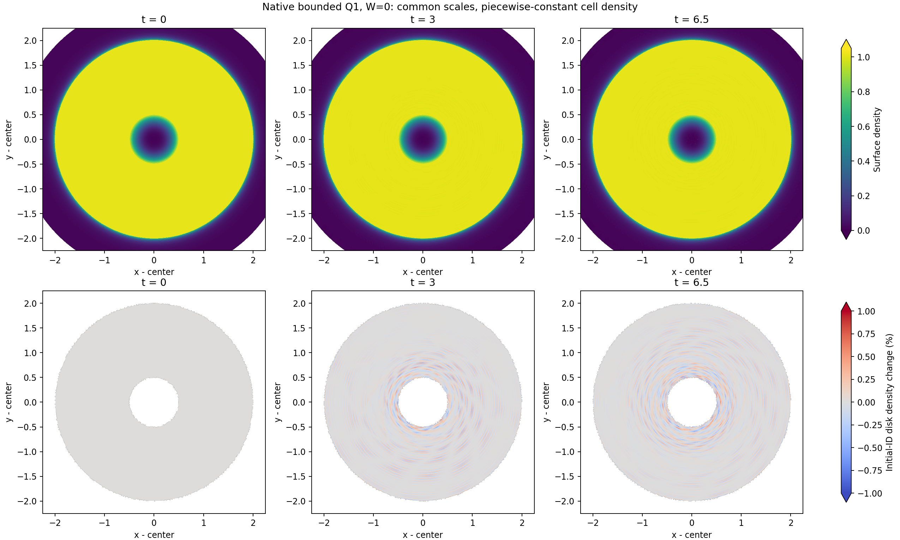

# Exact t=6.5: bounded Q1 disk gate passed; inner core is inaccurate

H200 job 439333 reached exact t=6.5 and saved `khout.011056.dat`, SHA256 `442d763945bb9b71360fa6b5f3d259ab712c6173b4c6ee5c752d3bcb4f1c0428`. All original 15 physics checks, unchanged nine radial checks and four extra state/event checks passed. The actual accepted-restart receipt and SHA were verified, and the same allocation continued toward t=10. No t=0 regeneration or accepted-state repair occurred.

This is a successful **disk checkpoint beyond t=6**, not a whole-domain accuracy result or completion of GIZMO t120/t600 and the radius-qualified approximately 1000-orbit objective. The 28 existing gates do not impose quantitative inner-core accuracy limits.

| Measure | t3 | t6.5 |
| --- | ---: | ---: |
| Disk mass-mean absolute density change | 0.0497882% | 0.0557021% |
| Disk mass-mean absolute log entropy change | 2.63466e-5 | 5.44014e-5 |
| Disk signed log entropy change | -1.11546e-5 | -3.21898e-5 |
| Disk mass-mean circular position error | 1.55980e-7 | 5.94764e-7 |
| Disk relative angular-momentum change | -1.8324e-12 | -3.4664e-12 |
| Total relative energy change from original IC | -1.23657e-6 | -2.06404e-6 |
| Core r0<.1 mass-mean absolute density change | 4.95735% | 33.4377% |
| Core r0<.1 mass-mean circular position error | 1.29815e-3 | 1.69791e-2 |

All 48,680 disk IDs and all 90,352 masses are preserved, W=0, Re=infinity, and no intrinsic spin or generator steering is enabled. Floor/dual/entropy-floor injections remain zero. Signed entropy is negative; the absolute entropy discrepancy is not evidence of positive physical heating.

Full density uses [0,1.05] in every panel; lower panels use [-1%,1%] for original-ID disk density changes. Colors saturate at fixed limits. White lower-panel regions exclude non-disk initial IDs; they do not measure vacuum. These full-scale density views do not resolve the small, low-density central core, whose large errors are explicitly reported above and in the saved distributions.

## Independent geometry and angular budget

All-site independent SciPy Voronoi cells clipped to the same polygon agree with native t6.5 volumes to at most 5.95639e-8 relative. Two auxiliary guard radii agree and area partition checks pass. `INDEPENDENT_GEOMETRY_T65.json` preserves the raw evidence.

The exact circular-site geometric reference gives disk mean absolute density change 0.0559457%, versus native 0.0557021%. Native density relative to that geometric reference differs by 0.0008637% in mass mean. Thus the small disk fluctuation closely follows geometric breathing at this time. This kinematic reference is not an exact finite-cell fluid solution or an entropy attribution.

The inner-core density differs from circular geometry by 33.5546% in mass mean, while that reference itself changes only 1.07072%. Stored-volume arithmetic therefore does not explain the observed core departure. The .1–.5 region also contains large tails: native-versus-circular density error cell p99 is about 21.6% despite its mass mean of 0.07799%. The uncorrected original-IC density p99/max in that region are 22.05%/343.0%. Original-IC r0<.1 density p99/max are 365.0%/590.3%. Percentiles are over cells, not mass quantiles.

Actual cumulative wall angular impulse divided by initial disk angular momentum is -7.73084e-15, with zero collisions. The separate fluid/wall/angular-integrator budget matches to 4.02e-20. Small wall torque does not rule out radial boundary effects or establish GIZMO boundary equivalence.

## Focused Astra assessment and the next decision

Astra reviewed the new t6.5 evidence once. Keep the unchanged t10 chain and its already submitted common-restart timestep controls. Do not promote the inaccurate coarse core state directly to t120/600. Existing gravity-only evidence supports a substantial time-integration contribution, but its 95%-explanation test failed and remains a failure. Mesh/integrator/weights/spin changes are not the first justified intervention.

After the incremental controls, the minimum additional physical branch is the existing native gravitational timestep cap, with the current RK4, force and mesh retained. Select the earliest preserved checkpoint satisfying predeclared core accuracy criteria; if none qualifies, reuse the original preserved t0 snapshot rather than generating another IC. Compare against existing coarse checkpoints instead of rerunning coarse evolution. A common damaged t10 restart measures additional integration sensitivity and cannot recover inherited errors.

The existing `EUNHA_KEPLER_DTETA` control bounds h by the minimum softened central orbital scale `eta*(r*r+eps*eps)^.75`, including an MPI global reduction, in the active RK4 path. It is currently zero. A cap's real wall time per physical interval must be measured before adopting it for long evolution. Core error distributions and regional energy/angular trends must be bounded before long-time promotion, then a single boundary radius/shape comparison remains required.

The pending job 439375's diagnostic-only revision adds regional percentile/max errors, normalized circular-position errors and incremental regional energy/angular momentum. Its run duration, native physics and original gates are unchanged. Slurm PENDING/Dependency and absence of an execution claim were verified before updating frozen hashes; the old contract/source were retained. `REGIONAL_DISTRIBUTIONS_T65.json` validates the added metrics against the independent checkpoint gate and a same-state zero-increment control. Regional invariants can exchange with other regions and are reported as diagnostics, not assumed separately conserved.
