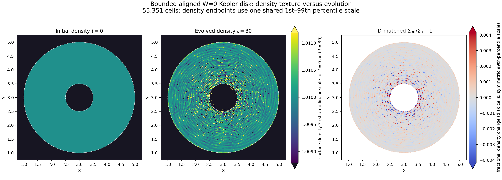

# Bounded aligned W=0 Kepler density texture: t=0 to t=30

## Inputs and verification

- Initial snapshot: `/gpfs/kjhan/LagForce/Kepler_BoundedPoly1024_A10_20261027/t001_v2/khout.000000.dat`, exact `t=0`.
- Endpoint: `/gpfs/kjhan/LagForce/Kepler_BoundedPoly1024_A10_20261027/wallselect_to30_a10_v1/khout.005247.dat`, exact `t=30`.
- Both contain 55,351 cells. Cell IDs are complete and match; cell masses are bitwise identical by ID; all weights are exactly zero.
- The initial and endpoint SHA-256 values are recorded in [the machine-readable comparison](KEPLER_Q2_BOUNDED_W0_DENSITY_T0_VS_T30_2026-10-28.json).

## Density figure

The two absolute-density panels use the same linear limits, `1.0087949–1.0111947`, computed from the combined disk-cell 1st–99th percentiles. Values outside that interval are saturated. Each pixel is assigned its nearest generator's stored density, without smoothing. The third panel shows the ID-matched fractional change at the t=30 cell positions.

The t=0 disk is nearly uniform at this scale. The t=30 state has a pronounced ring texture, concentrated toward the inner disk. This structure is therefore generated during this evolution, rather than inherited as an obvious density pattern in the initial snapshot. The image alone does not identify the force or discretization term that produces it.

### Shared-scale density contrast and inner zoom

The absolute-density panels above already share one linear scale, but that scale makes the near-uniform t=0 field and the small inner-disk contrast difficult to inspect together. The companion [contrast and inner-zoom figure](KEPLER_Q2_BOUNDED_W0_DENSITY_DETAIL_T0_VS_T30_2026-10-28.png) displays `100 (rho/rho_ref - 1)` with one symmetric color range across all four panels. Here `rho_ref=1.00999999` is the initial disk's mass-weighted mean density; the displayed limits are ±0.4155%, set by the combined disk 99.5th percentile. The lower row zooms to `2 <= x,y <= 4`, preserving the same color scale as the full-disk row. The initial density is exactly uniform in this cohort, while t=30 shows alternating local density deviations, strongest near the inner edge. The raster remains a nearest-generator, unsmoothed visualization; the mask follows the same cells selected by initial radius.

The machine-readable settings and measured contrast values are in [the detail-plot summary](KEPLER_Q2_BOUNDED_W0_DENSITY_DETAIL_T0_VS_T30_2026-10-28.json), and the [plot script](plot_kepler_bounded_t0_t30_density_detail_20261028.py) reproduces the figure.

For closer inspection of the inner disk, the [focused t=0/t=30 density-field pair](KEPLER_Q2_BOUNDED_W0_DENSITY_T0_T30_INNER_FOCUS_2026-10-28.png) uses a single shared symmetric contrast range of ±1.224%, chosen from the 99.5th percentile of the initial-radius `0.50–0.75` cohort. Both panels use the same initial disk reference density; the displayed Lagrangian cohort is `0.50<=r0<1.00`. The image is an unsmoothed nearest-generator raster. Its [settings and summary](KEPLER_Q2_BOUNDED_W0_DENSITY_T0_T30_INNER_FOCUS_2026-10-28.json) and [reproduction script](plot_kepler_bounded_t0_t30_density_inner_focus_20261028.py) are recorded alongside it.

## ID-matched density change

Initial-radius bins are used so cells remain in the same Lagrangian cohort:

| Initial radius | Cells | Mass-weighted mean |ΔΣ/Σ0| | Signed mass-weighted mean | 99th percentile |ΔΣ/Σ0| |
|---|---:|---:|---:|---:|
| 0.50–0.65 | 2,323 | 1.67480e-3 | 1.06647e-5 | 1.33526e-2 |
| 0.65–0.75 | 1,608 | 9.11706e-4 | 3.23734e-6 | 8.06278e-3 |
| 0.75–1.75 | 33,173 | 3.13527e-4 | 3.37914e-7 | 2.57713e-3 |
| 1.75–2.00 | 11,934 | 1.86527e-4 | 6.04774e-5 | 8.69483e-4 |
| 0.50–2.00 | 49,038 | 3.66723e-4 | 1.55579e-5 |  |

The inner `0.50–0.65` cohort's absolute density change is about **9 times** the `1.75–2.00` cohort's, while its signed mean remains near zero. This indicates largely alternating local changes rather than a comparable net density shift. The inner-bin 99th percentile is much larger than its mean, so a small subset of cells carries the strongest excursions.

## Cross-check against the older `rho0p7` t=120 run

The run's script set `HYDRO_TSTOP=120`, but its Slurm log records the step cancelled at `t=65.3418` on 2026-10-04. The last complete saved snapshot is `t=64.00094`; the cancellation reason is not present in the retained log. Thus this older run does not provide a t=120 result.

The raw t=2.02621 and t=64.00094 snapshots were independently re-read. Cell IDs match and cell masses are bitwise fixed. The saved [t=64 cohort audit](KEPLER_OLD_RHO07_T2_TO_T64_LAGRANGIAN_AUDIT_2026-10-28.json) gives, for the initial `0.50–1.00` cohort, internal-energy-sum ratio **4,071**, mean `Δln K=4.092`, and RMS fractional-radius drift **8.68%**. The `1.00–2.00` cohort has internal-energy ratio **1.057**, mean `Δln K=0.0212`, and RMS fractional-radius drift **0.0481%**.

Using the cell-integrated `ie` field (`P=(γ−1)ie/V`) and the run's `ε=0.01`, the global total-energy change from the t=2.02621 snapshot to t=64.00094 is `1.58e-6` relative. The relative angular-momentum change is `−1.30e-7`. This run therefore combines strong inner-disk entropy growth and radial migration with good global energy and angular-momentum conservation. Global conservation alone does not establish local Kepler-flow stability.

This older ring IC and code lineage differ from the bounded t=30 control. Its late-time behavior supports the need for initial-radius-resolved thermodynamic and orbit gates, but does not alone identify the cause of the new t=30 texture or predict the current q1 continuation.

## Scope and next gate

The bounded t=30 case is an aligned, fixed-polygon W=0 control with 55,351 cells. It is useful for locating inner-disk error but is not the paper's periodic, approximately `256^2` setup and does not validate the t=600 benchmark. Continue the already-running matched candidate trajectories to their exact t=6.5 gates; use their radial density and entropy receipts to decide whether the inner texture is reduced before extending a checkpoint.

### Revised inner-core comparison

To make the t=0/t=30 comparison easier to read, the [inner-core density figure](KEPLER_Q2_BOUNDED_W0_DENSITY_T0_T30_INNER_CORE_SHARED_SCALE_2026-10-28.png) uses only the Lagrangian cohort with initial radius `0.50<=r0<0.75`. Both panels use one symmetric linear contrast range of ±1.22398%, based on the combined 99.5th percentile. The native nearest-generator raster is 1800×1800 pixels per panel and is not smoothed; 40 of the 3,931 cohort cells at t=30 exceed the displayed range. The [reproduction script](plot_kepler_bounded_t0_t30_density_inner_core_20261028.py) and [settings/summary](KEPLER_Q2_BOUNDED_W0_DENSITY_T0_T30_INNER_CORE_SHARED_SCALE_2026-10-28.json) record the exact inputs and scale.

### t=30 full-disk view with a shared-scale inner zoom

The [updated t=30 density figure](KEPLER_Q2_BOUNDED_W0_DENSITY_T30_COMMON_SCALE_FULL_INNER_2026-10-28.png) shows the full disk and an inner zoom with the **same** color normalization and colorbar. Color represents the linear density contrast `100(Σ/Σ_ref−1)%`, relative to the initial disk's mass-weighted mean `Σ_ref=1.01`; the shared range is ±0.1892%, the 97.5th percentile of the absolute contrast among initial disk cells. About 2.5% of disk cells exceed that range and are saturated. The native nearest-generator raster is unsmoothed. Reproduce it with [the plotting script](plot_kepler_bounded_t30_common_scale_full_inner_20261028.py); exact input hashes and display settings are in [the summary](KEPLER_Q2_BOUNDED_W0_DENSITY_T30_COMMON_SCALE_FULL_INNER_2026-10-28.json).
