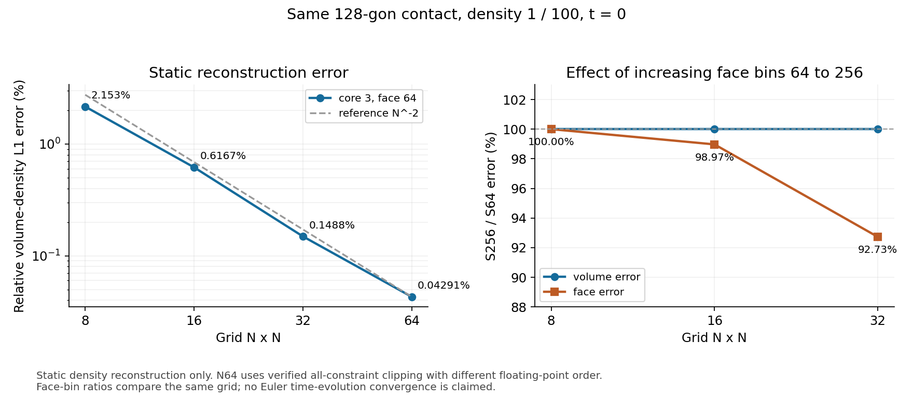

# 마흔한 번째 2D 묶음: N8 연속 진화와 오차 원인 분리

## 최종 요약 — 2026-10-16 17:11 KST

이번 묶음은 종료 상태까지 확인했다. 현재 이 묶음의 계산 프로세스는 없다. 다음 연구는 기존 승인 범위에서 진행하며 개별 테스트 승인을 다시 요구하지 않는다.

| 검증 | 결론 |
|---|---|
| 동일 물리 곡면의 정적 재구성 | 8²/16²/32²/64² 체적L1 = 2.1530% / .6167% / .1488% / .04291%; 인접 관측차수1.80/2.05/1.79 |
| 곡면의 유체 RHS/첫 시간 스텝 | N8/N16 순간 HLLC/positive RHS 통과; N8의 dt1e-5 통과. 그 끝의 참조 셀질량L1=1.5853e-7 |
| 원 N8/0도 local 방식 | CI가120분 제한으로17:04:24 exit124. t=5.85151232755631e-05, 이 구간56승인/12거절. 목표 .00011 미완료 |
| 수치 개선 분기 | 해석 cap CK/셀중심 CT도 각각 시간 제한으로 목표 미완료. 승인 상태와 pending 보존 |
| 단일 평면 방향 가설 대조 | CW/DA가 .00011까지13승인/3거절 완료, 체적L1=5.7562e-9. 원 방식의 완료나 일반 곡면 closure 성공으로 대체하지 않음 |
| 실패 원인 분리 | N4는 잘못된 밀도 범위, N8/N16 core2는 유한 기저 부족. core3/4에서는 전체 곡면 재구성 통과 |
| 코드/무결성 | 관련 회귀77개 통과. 현재257개 Python 파일이 해당 검증 snapshot과 동일. 종료35실행의 immutable8670건/결과·입력819건 hash 불일치0 |

무조향과 고정질량은 모든 분기에서 유지했다. 가중치는 시간에 따라 변한다. N64의 기하 절단 순서 변경과 각 수치/정규화 분기는 명시적으로 구별했다. 이 결과는 정적 재구성 및 특수 affine 접촉 유동의 검증이며, 일반 Euler/3D/케플러 검증의 완료를 뜻하지 않는다.

### 오차 지표의 뜻

- 체적 밀도 상대L1: 전체 물리 참조질량으로 정규화한 density field 오차. 같은 물리 IC 격자 비교에 사용한다.
- closure_moment_error: 셀 중심/면적 척도로 정규화한6모멘트 제약의 최대 잔차. 밀도장 자체의 상대오차가 아니다.
- 참조 셀질량L1: 움직이는 현재 셀에 정확한 물리 밀도를 적분한 값과 고정된 수치 질량의 차이. 수치 질량 배열의 변화와 구별한다.
- 면 상대L1: 격자마다 정규화와 면 집합이 변하므로 격자 간 로그비를 점별/PDE 수렴차수로 선언하지 않는다. 면64/256 비교는 같은 격자 내에서 한다.
- 경로 검사는 저장된 표본의 질량률/적분/양의상태를 검증한다. 연속 시간 전체에 대한 수학적 상한 증명으로 과장하지 않는다.

최신 코드와 이 문서의 durable 보존 위치: `/gpfs/kjhan/LagForce/Codex_DC_failure_classification_20261016_165610/` 및 그 `review_source/`.
아래는 실험 순서와 당시 판단을 남긴 역사 기록이다. 진행 중 표기는 이 최종 요약과 끝의 종료 기록으로 대체한다.

사용자의 계속 진행 지시와 기존 2D 테스트 사전승인에 따라 진행한다. 고정 질량, 생성점 조향 없음, 수치 상태만을 사용하는 local moment 재구성을 유지한다.

## BT: N8을 동일 비교 시각까지 연장

`/gpfs/kjhan/LagForce/Codex_BT_n8_extended_20261016_135021`

lageunha의 foreground SSH 실행. 이전 BR의 두 각도 최종 t=1e-5 상태에서 t=.00011까지 이어간다. 0도는 이전 31개 승인 스텝, 23도는 이전 1개 승인 스텝을 보존한다. 실제 마지막 상태/공분산 인자/질량 배열을 그대로 유지하고, 0도의 누적 진단만 명시적으로 연결했다. 연결 출처 원문과 해시는 preserved/ 및 sources.json에 보존한다.

두 사례는 독립 병렬이며 각각 경로 작업자24개, BLAS/OpenMP 스레드1개다. 초기 최대 dt=2.5e-5, epsilon=1e-7, 면64구간, 기존 질량/압력/경로 오차 기준을 유지한다. Gauss2는 실제 source의 Gauss4 대조가 통과할 때만 선택한다. 실행 전 기존 회귀40개 통과. 결과는 종료 후 추가한다.

준비 단계에서 FINAL_STATUS의 키를 passed로 잘못 가정한 검사가 계산 전 중단됐다. n8_short_gate_passed 및 원 common_continuation_report의 passed를 각각 검사하도록 수정한 뒤 새 디렉터리를 준비했다. 실패한 준비 디렉터리에서 시뮬레이션은 실행하지 않았다.

## 시간 수렴 판정 보완

거절이 없는 적응 계산도 승인 dt를 줄일 수 있다. 시간 수렴차수는 실제 승인 스텝 수와 각 스텝의 dt를 모두 확인해 균일한 세 격자일 때만 계산한다. 반올림 screen 아래의 차이도 차수를 출력하지 않는다. 기존 계산 소스/결과는 변경하지 않았다.

## 이번 묶음의 추가 비교

- N3/23도 저장 상태에서 더 긴 구간의 시간 정밀화를 별도 수행한다. 경로 제어 시간척도 변경을 명시하며 재구성·물리 모델은 동일하게 유지한다.
- 같은 시작 상태에서 면256구간을 실제 진화에 사용하고 기존 면64구간 진화와 비교한다. 사후 재구성 비교와 구별한다.
- BT 완료가 확인된 뒤에만 N3/N4/N8의 t=.00011 비교를 수행한다. 완료 전 결과를 추정하거나 공간 수렴차수를 선언하지 않는다.

### 실행 중인 독립 비교

BU `/gpfs/kjhan/LagForce/Codex_BU_long_time_20261016_135325`:
N3/23도 BG의 승인 t=.00011 상태에서 .00051까지 이어간다. 먼저16스텝 coarse가 실제 완료/통과하면 그 결과를 재사용하여32/64스텝을 독립 병렬 비교한다. 원 IC/저장 시작 상태/질량/밀도 재구성/면64구간은 동일하다. 구간 길이에 맞춰 path_control_horizon=.0004로 명시했고 총 질량 예산5e-11과 최종 판정 기준은 유지한다. 경로 작업자12개씩, BLAS/OpenMP1개. 회귀43개 통과.

BV `/gpfs/kjhan/LagForce/Codex_BV_face_evolution_20261016_135325`:
BG N3/23도의 실제 t=1e-5 상태에서 면256구간으로 t=.00011까지 진화한다. 기존 면64구간4스텝 결과를 기준으로 재사용한다. 실제 승인 시간격자가 같아야 면 구간 수만 바꾼 비교로 해석한다. 경로 작업자8개, BLAS/OpenMP1개. 판정 회귀5개 통과. 두 계산 모두 BT와 독립적이며 foreground SSH로 종료까지 모니터링한다.

### 실행 환경변수 오류 및 수정 이관

BU/BV 스크립트 생성 시 일반 문자열 WORKERS를 치환하면서 환경변수 이름 안의 같은 문자열도 바뀌었다. 실제 변수는 LAGFORCE_PATH_12/8이 되어 두 계산 모두 기본 path_workers=1로 실행됐다. 위의12/8은 의도한 값이며 실제 실행값이 아니었다. BT의 LAGFORCE_PATH_WORKERS=24는 정상이다. 이 오류를 숨기거나 병렬 성능 결과로 해석하지 않는다.

BV는 이미4스텝을 완료해 재실행하지 않았다. BU는14:03:41에 PID25594의 원 cwd를 확인하고 그 프로세스만 TERM으로 종료했다(exit143). 승인5스텝 t=.000235, 거절0, 다음 pending 경로와 계산 표본을 보존했다.

BY `/gpfs/kjhan/LagForce/Codex_BY_long_time_resume_20261016_140409`:
BU의 모든 승인 스텝/원 입력/pending/표본을 해시 대조해 복사하고, 동일 입력에 한해서 재개하도록 driver를 보완했다. 환경변수는 명시적으로 LAGFORCE_PATH_WORKERS=12를 설정/검사하고 runtime_env.txt에 남긴다. 이미 승인한5스텝을 다시 진화하지 않는다. 수치식과 원 coarse 구간/정밀화 설정은 동일하다.

### BV 완료 결과

lageunha13:53:35–14:02:53, exit0. 실제4스텝/거절0, 기존S64와 승인 dt도 모두 같았다. 질량 배열 정확 보존, 모든 참조/경로/압력/장부 gate 통과.

| t=.00011 실제 진화 | S64 기존 | S256 새 계산 |
|---|---:|---:|
| 체적 밀도 상대L1 |1.48149e-8|2.03333e-9|
| 정답 셀질량 상대L1 |3.30810e-9|4.80728e-10|
| 점별 면 밀도 상대L1 (%) |.245407|.0661673|

이 한 사례에서 체적 오차 약7.29배, 면오차 약3.71배 감소했다. 같은 시작 상태·시간격자로 면 구간 수만 바꾼 실제 진화 비교이며, 일반 공간 수렴차수나 모든 계면에서의 개선을 주장하지 않는다. 정답 셀질량 오차는 저장된 실제 질량이 변했다는 뜻이 아니다.

## 읽기 전용 비용 진단 및 완료된 다섯 endpoint 비교

BW `/gpfs/kjhan/LagForce/Codex_BW_path_cost_20261016_135815`: 저장된 승인 경로의 한 표본씩 N3/N8에서 재평가,13:58:26–13:58:38 exit0. 원 질량률 재현 차이 모두0. cProfile 포함 표본 비용2.63/6.58초, 계면 방향의 다각형 절단이 큰 비중을 차지했다. 이 두 표본을 전체 프로그램의 가속비로 해석하지 않는다.

BX `/gpfs/kjhan/LagForce/Codex_BX_rhs_cost_20261016_140134`: N3 원 source RHS의 Gauss4/2 대조14:01:43–14:01:50 exit0, 상대 차이4.145e-15. 같은 provider cache를 공유한 순차 프로파일이므로4.84/1.24초의 비를 순수 적분차수 가속비로 해석하지 않는다. 실제 BU/BY/BV는 Gauss4를 유지한다.

BZ `/gpfs/kjhan/LagForce/Codex_BZ_extended_comparison_20261016_140457`: 이미 완료/통과한 N3/N4 네 endpoint와 N8/23 endpoint만 같은t=.00011에 비교한다. N8/0은 아직 계산 중이므로 포함하지 않았다. 원 상태/출처 해시를 실행 전에 검사하며, S64/S256 사후 재구성을 비교한다.

### BT 실행 이관과 CA

BT의23도는6개 새 승인/1거절로t=.00011까지 완료/진화 gate 통과했다.0도는 질량 및 적분오차 제어에서 작은 dt가 필요했고,3개 새 승인/5거절로t=1.3624870540912838e-5에 도달했다. 현재 저장 상태 및 pending 표본을 이용해 실행 병렬도만24→48로 늘렸다.

14:07:09 BT timeout의 process group20785에 속한29개 프로세스의 원 cwd를 모두 확인한 뒤 해당 group만 TERM으로 종료143했다. 완료된23도를 다시 진화하지 않는다.

CA `/gpfs/kjhan/LagForce/Codex_CA_n8_workers48_20261016_140727`:
BT0도의 입력/원 source/3개 승인 스텝/5개 거절 및 현재 pending 경로/표본24개 파일을 해시 대조해 복사했다. 같은 구간의 checkpoint와 pending cache에서 이어간다. 재구성식·시간 갱신식·질량/적분 예산·동일 구간 구성은 유지한다. 동일 실험 입력인지 검사한 뒤에만 재개한다. runtime_env.txt의실제 경로 작업자48, 회귀44개 통과. 전체 역사에 포함할23도 완료 보고서/상태도 preserved_completed/에 보존했다.

### BZ 완료와 실제 진화 비교의 의미

다섯 사례/10재구성 모두 passed. 같은t=.00011의 S64 체적상대L1은N3/0 6.177e-9,N3/23 1.481e-8,N4/0 1.116e-8,N4/23 4.816e-9,N8/23 6.165e-9다. 해상도에 대해 단조롭게 감소하지 않으므로 공간 수렴차수를 선언하지 않는다.

N3/23의 S64 진화 끝점을 사후에 S256으로만 재구성하면 체적오차1.449e-8이며, 실제 S256으로 진화한 BV 끝점은2.033e-9다. 사후 표시만 정밀화하는 것으로는 진화 중 생긴 모멘트 오차를 제거하지 못한다는 근거다. 이 한 사례의 통제 비교이며, S는 면 프로파일과 얇은 경계층의 분할을 함께 바꾼다. 둘의 영향을 이번 결과만으로 완전히 분리했다고 주장하지 않는다.

## CB: 고정된 실제 경로의 고빈도 변동 대조

`/gpfs/kjhan/LagForce/Codex_CB_path_noise_20261016_141318`
lageunha14:13:30–14:14:23, exit0, noise_report passed. CA의 실제 승인4번 스텝은257→513→1025(+focus257)에서 같은 적분 예산을 통과했다. 그 경로와 모든 m/q/Q/기하율을 고정한 채33개 인접 표본 s=496/1024..528/1024에서 local/polish/global을 대조했다. 가중치 재풀이와 시간 진화는 하지 않았다.

| 재구성 | 35번 셀 질량률/m의 2차 추세 잔차RMS | 원 질량률과 최대 절대 차이 |
|---|---:|---:|
| 기존 local |1.013e-7|0 정확 재현|
| local+방향 polish |8.668e-8|3.329e-9|
| global 평면 방향 가설 |2.727e-12|5.713e-6|

모든 대조의 모멘트 오차<=6.662e-16, 밀도>0. 기존 스텝의 전체1025점에서 최악 셀 질량률은 -4.631e-7..3.834e-7 /시간이며, 인접차분의 부호가691번 바뀌었다. 고빈도 변동이 적분 표본 수를 늘리는 한 요인이라는 근거지만, 그 전체 원인을 단독으로 증명하지 않는다.

polish는 충분한 개선이 아니어서 주 진화에 채택하지 않는다. global 가설은 변동을 크게 줄여도 기존 가중치 경로의 최대 |massrate/m|가3.618e-4로 바뀐다(기존 local2.760e-7). 기존 path_control_horizon1e-4로 정규화하면3.618e-8로 점별 기준5e-9를 초과한다. 매끄러운 지표 하나만으로 같은 경로의 통과 대안이라고 볼 수 없다. global은 별도 모델 가설로만 보존하며 실제 CA/BY/BV 모델을 바꾸지 않았다.

## CC: 유한 전환 대역 내부의 물리적 초기상태

`/gpfs/kjhan/LagForce/Codex_CC_phase_band_20261016_141826`
lageunha14:18:40–14:18:56 exit0, 네 정적 대조 모두 통과. 기존 진화를 초기화한 것이 아니라, 전환 대역을 직접 검사할 새 공통 평면 IC를 구성했다. 기하 꼭짓점 근처를 지나는 초기 평면의 각도를 탐색해 정확한 두상 밀도장의 m/q/Q를 적분했다. 선택된 N3 각도 -127.16509192773806도,1번 셀의 실제 추정 소수상 분율2.49999999943e-7, epsilon1e-7의 혼합계수.499999999715다.

각 epsilon에서 자체 순간 가중치율을 풀고 압력/선형속도/질량/모멘트/양의밀도/체적예산/장부 및 참조 유효성을 검사했다. 시간 진화나 원 가중치 경로의 대체가 아니다.

| epsilon | 대상 셀 상태 | 체적 밀도 상대L1 | 면 밀도 상대L1 (%) |
|---|---|---:|---:|
|0|완전 계면|1.591e-9|.135389|
|1e-8|완전 계면|1.591e-9|.135389|
|1e-7|혼합 beta≈.5|1.368e-7|.135329|
|1e-6|균일 prior|2.717e-7|.135269|

전환 대역에서 epsilon이 실제 재구성 오차와 순간 가중치율을 바꾼다는 직접 근거다. BH의 대역 밖 표본 동등성을 일반화하지 않는다. 유한 정규화는 모델 정확도에 비용을 가지며 단순 solver tolerance가 아니다. 시간에 따른 대역 통과·epsilon→0 수렴·일반 진화해 존재는 여전히 별도 검증이다.

## 시간 비교의 최종시각 판정 수정 준비

BY의32스텝 실제 끝 시각 .0005099999999999997과16스텝의 .00051은 약3e-19 다르다. 기존 분석 코드의 정확한 실수 동일성 비교는 이 경우를 오판한다. 실제 진화와 원 파일을 바꾸지 않고, 목적 시각에 대한64*machine-epsilon*시간규모 이내의 차이만 허용하도록 분석을 수정했다. 각 승인 dt/스텝 수의 균일성 검사는 그대로 한다.

CD `/gpfs/kjhan/LagForce/Codex_CD_time_analysis_20261016_142131`:
새 분석의 회귀 및 기존 BJ 결과의 핵심 수치 정확 재현을 먼저 확인한다. BY의64스텝이 실제 종료/진화 gate 통과한 뒤에만 저장 결과를 읽어 최종 시간 비교를 수행한다. 원 BY snapshot은 보존하며 성공 스텝을 다시 적분하지 않는다.

### BY/CD 최종 시간 비교 완료

BY는14:27:58에 종료1했다. 세 실제 진화16/32/64는 모두 완료/각 물리·경로 gate 통과/거절0이며, 실패는 원 snapshot의 끝 시각 정확 동일성 비교에만 있었다. 원 로그는 보존했다. CD의 회귀45개 및 기존 BJ 핵심수치8항목 정확 재현이 먼저 통과했고,14:29:08–14:29:19 읽기 전용 최종분석은 exit0/passed다. 기존 스텝을 재적분하지 않았다.

실제 승인 dt는각2.5e-5/1.25e-5/6.25e-6(마지막 스텝의 반올림차만 있음),같은 source t=.00011/같은 물리모델/S64/Gauss4/정규화 epsilon1e-7이며 목적 시각은.00051이다.

| 인접 시간격자 | 최대 raw moment/mass 차이 | gauge 제거 가중치 차이 |
|---|---:|---:|
|16 대32|1.683603160e-12|2.362716455e-13|
|32 대64|4.224166393e-13|5.905559006e-14|

raw moment/mass 차이의 관측차수는1.99481355,두 차이 모두 roundoff screen1.666350169e-13 위다. 가중치의 두 번째 차이와 생성점/장부 차이는 screen 아래여서 차수를 선언하지 않는다. 특수한 이 사례에서의 모멘트 시간2차 자기수렴 근거이며 일반공간2차/모든변수2차/전체PDE수렴 증명은 아니다.

정확해 셀질량 상대L1은16/32/64에서1.529532041e-8/1.529624936e-8/1.529648262e-8,거의 변하지 않는다. 시간차이가 줄어도 참조오차가 유지되는 점과 BV의 실제 S256 개선을 함께 보면, 이 조건에서는 시간보다 공간 표현/재구성 오차를 우선 조사해야 한다는 근거가 강화됐다.

## CE/CF: 정확도와 계산 비용의 명시적 정규화 대조

CE `/gpfs/kjhan/LagForce/Codex_CE_regularization_trial_20261016_143601`
lageunha14:36:13–14:39:06 exit0. BT의 실제 첫 거절(0도,t=1e-5,dt=2.5e-5)과 같은 저장 상태를 사용한다. 원 baseline trial은 원문/해시와 함께 재사용했고 재계산하지 않았다. 새 trial만 epsilon1e-7→1e-5로 바꿔 자기 순간 가중치율과 RK2 단계를 풀었다. Gauss2/4 source차1.336e-14 확인 후2를 선택했다.

질량/질량률/적분오차/압력/양의인자/모멘트/장부 gate는 유지했다. 원 epsilon1e-7 trial ratio158.808은 거절,새 epsilon1e-5 trial은257+focus65 ratio.0752262로 통과했다. 이는 재구성 모델 변경의 효과이며 허용오차 완화나 원 모델의 통과가 아니다.

| N8/0 같은 source t=1e-5 | epsilon1e-7 | epsilon1e-5 |
|---|---:|---:|
| 체적 밀도 상대L1 |6.892e-10|6.066e-7|
| 면 밀도 상대L1 (%) |.0742277|.0833151|

새 trial 끝t=3.5e-5의 체적L1은6.183e-7,면L1 .0825135%다. 계산이 쉬워지면서 작은 소수상 구조의 정확도 비용이 발생한다. 정확도 비용을 숨기고 수정 완료로 보고하지 않는다.

CF `/gpfs/kjhan/LagForce/Codex_CF_regularized_continuation_20261016_144054`:
CE의 통과한 첫 trial의 실제 단계 값/새 상태/65 및257+focus 표본을 그대로 pending cache로 보존해, 나머지를t=.00011까지 이어간다. 첫 스텝의 RHS/경로 표본을 다시 계산하지 않는다. 경로 작업자16개,BLAS/OMP1개. epsilon1e-5 모델은t1e-5 이후의 별도 분기이며 원 prefix는epsilon1e-7이었다. 원 CA의epsilon1e-7 진화는 그대로 유지한다.

14:34 자원 확인에서 h200 노드도CPU64개로 확인되어 Slurm으로 이전하지 않았다. CPU 기반 경로 계산을 GPU 계산으로 보고하지 않는다. 별도 Slurm 제출 없음.

### CA 원 모델 종료와 고정 경로 추가 감사

CA는14:45:19 exit2로 종료했다. 같은 epsilon1e-7의0도 구간은20개 승인/7거절,t=3.433562490989914e-5까지이며, 이전t0→1e-5의31개 승인은 별도로 보존된다. 다음21번 trial dt=1.0790499724346155e-6의 적분 ratio는257/513/1025에서1.86104/1.16416/1.49355였다. 마지막 quadrature ratio가1보다 커 프로그램의명시적1025한도에 도달했다.

이는 원 모델의t=.00011 도달 실패이고,기하 붕괴/해의 수학적 비존재를 증명한 결과가 아니다. 원 result/pending/65표본/1025+focus257표본과 모든 승인/거절 파일을 보존했다. 실패를 통과 목록에서 제거하지 않는다.

CG `/gpfs/kjhan/LagForce/Codex_CG_fixed_path_quadrature_20261016_145016`:
이 실패한 trial을 고정하고,원1025결과를 재현한 뒤2049+focus513,필요하면4097+focus1025까지 적분 표본만 늘린다. 원 표본은 정수 lattice를 정확히4배 확대해 재사용한다. 가중치 재풀이/RHS단계/실제 시간 진화를 다시 수행하지 않는다. 같은 epsilon1e-7과 질량/적분 예산을 사용한다. 이 감사가 통과해도 전체 원 진화의 성공으로 보고하지 않는다.

### CF 별도 분기 완료

CF의t1e-5→.00011은4승인/거절0으로완료/통과했다. 첫1스텝은CE의실제단계와표본을그대로재사용했다. 네 스텝 모두257+focus65에서 같은 예산을 통과했다. 최종체적밀도상대L1 6.521522235e-7,면상대L1 .08211994%다. 실제질량배열은원값과정확히같고조향/고유값절단없음.

epsilon1e-5가 이구간의계산을쉽게했지만,시작상태부터체적오차가6.066e-7로증가한모델의정확도비용이있다. 원epsilon1e-7의N8/0미완결과와합쳐동일모델의격자수렴이나방법(3)완료로선언하지않는다.

### CG 저장 코드 오류와 CH 고정 경로 감사 완료

CG는원1025캐시의적분을재현한뒤dict에focus_nodes를중복전달하는저장코드오류로14:51:51 exit1했다. 새표본계산전오류이며원CA의수치실패와구별한다. 원코드/로그를보존했다.

CH `/gpfs/kjhan/LagForce/Codex_CH_fixed_quadrature_corrected_20261016_145443`
14:54:51–14:57:27 exit0. 같은원trial/캐시에서1025+focus257 ratio1.4935455348960196을정확히재현(새표본0)하고,추가1264개표본으로2049+focus513 ratio.5766961438489088에통과했다. 시간간격/가중치율/RHS단계/정규화폭/오차예산은바꾸지않았다. 같은고정경로의적분해상도를높이면기준을만족한다는근거이며전체진화완료아님.

### CI: 원 모델의 계산을 재개하기 위한 보완

CI `/gpfs/kjhan/LagForce/Codex_CI_original_recovery_20261016_150256`
원epsilon1e-7,S64,조향없음/고정질량/RK2와모든물리예산을유지한다. 필요시적분표본상한만선택적으로4097까지허용한다(기존기본1025유지). 새상한도257/513/1025에서기준을통과하면그수준에서멈추므로기존승인스텝의판정은유효하다.

경로작업자는매표본마다큰trial자료를전달받는대신,trial파일경로와SHA256을받고작업자별한번만읽는다. 새trial의digest가달라지면다시읽고,파일내용과digest가다르면평가전에실패한다. 이옵션은실행자료전달만바꾸며RHS/재구성식은바꾸지않는다. 기본옵션과기존호출경로를유지했다.

원20개승인/7거절과마지막pending경로를복사했다. input/checkpoint의변경은max_path_quadrature_nodes메타데이터뿐이며state/mass/factors/t/dt/누적진단이정확히같음을검사했다. CH의2049+focus513검증표본을pendingcache로사용해21번trial을다시RHS계산하지않고이어간다. 원실패result는preserved_failures에보존하고활성result로위장하지않는다.

회귀및실제원표본5개와filecache경로의정확일치검사를통과해야진화를재개한다. 경로작업자48,실행flag LAGFORCE_PATH_RECORD_CACHE=1. 실제통과/진행결과는검사후기록한다.

## CJ/CK: 다각형 cap 면적의 해석적 역산 대조

CJ `/gpfs/kjhan/LagForce/Codex_CJ_cap_inverse_20261016_151327`는 15:14:16–15:15:42 exit0. 볼록 다각형을 삼각형 cap의 구간별 2차식으로 표현해 고정 법선에서 원하는 면적의 절단 위치를 역산한다. 최종 다각형 절단은 기존 GEOS이며, Laguerre 셀 생성 알고리즘을 바꾼 것이 아니다. 기본 경로는 원 이분법으로 유지했다.

원 고정 경로의 9개 표본을 서로 독립된 프로세스에서 평가해 원 질량률을 정확 재현했다. 시간은 49.870초→18.013초(이 표본에서 2.768배)였고, 새 질량률은 최대 9.349e-9 차이가 있어 수치적 동일성은 없다. detrend RMS도 2.108e-7→1.503e-7로 줄었지만 잡음이 사라지지 않았다. source 정적 밀도L1은 2.02909e-9/2.02940e-9로 유사하고 양쪽 순간 RHS/재구성 gate를 통과했다. 전체 프로그램 가속비로 일반화하지 않는다.

CK `/gpfs/kjhan/LagForce/Codex_CK_analytic_branch_20261016_151930`는 CI의 실제 승인 t=4.5127681042413955e-5 상태에서 이 역산만 별도 활성화했다. epsilon1e-7/S64/오차 예산/고정 질량/무조향은 같고 자체 RHS와 가중치율을 푼다. 회귀55개 통과 후 시작했으며 원 prefix는 이분법이다. CI 원 모델은 독립적으로 계속된다. CK를 처음부터 동일한 수치 모델의 진화로 합치지 않는다.

## CL: 곡면 접촉면에서 기존 밀도 상한의 모순 발견

CL `/gpfs/kjhan/LagForce/Codex_CL_curved_static_20261016_153252`는 15:33:55–15:34:23 exit0로 진단을 완료했지만 원 core2 재구성은 N4/N8/N16 모두 실패했다. 반지름 .22, 중심 (.5,.5)의 정128각형 내부 rho100, 외부rho1을 동일한 물리 초기상태로 정의하고 정확한 다각형 교집합으로 m,q,Q를 적분했다. 원/분석적 원을 참조로 한 것이 아니라 정128각형 자체가 정확한 물리 IC다. 모멘트 분할 오차는 4.43e-16 이하였고 참조 계면은 초기화와 사후 점수에만 사용했다.

새 `density_moment_bounds.py`는 phi=(1,(x-cx)/s,(y-cy)/s), G=integral(phi phi^T), R=integral(rho phi phi^T)에 대해 L<=rho<=U이면 L G<=R<=U G임을 이용한다. 일반화 고유값의 극값은 가능한 밀도 범위의 필요조건이며, 대응 고유벡터는 음수가 아닌 제곱 다항식 증명값을 준다. 모멘트 수정/고유값 절단은 하지 않는다. 단위 검사3개 통과.

N4에서는 셀 평균 최대66.91046에 기반한 상한67.57956604가 실제 모멘트의 필요 상한96.08210606보다 작고 4개 셀에서 위배된다. 어떤 내부 기저나 최적화 기법을 써도 그 상한과 원 물리 모멘트를 함께 만족시킬 수 없다. 이는 실제 rho1/100 해의 비존재가 아니라, 미해상 최고 밀도를 셀 평균 최대치로 제한한 재구성 정책의 문제다. N8/N16의 [.99,101] 범위는 실제 물리 밀도를 포함하지만 core2 내부 표현에서 bulk LP가 실패했다.

## CM/CN: 기저 부족의 증명과 전체 재구성 회복

CM `/gpfs/kjhan/LagForce/Codex_CM_curved_basis_20261016_155131`는 N8의 첫 실패 셀18, N16의 셀182에서 같은 밀도 범위로 max|A u-b|를 최소화했다. core2 최소 잔차는 각각 약6.36e-5/1.35e-5이며, core3/4에서는 1e-8 아래의 양의 모멘트 witness가 존재한다. 이 축소 검사는 면 조건이나 체적 오차 예산을 포함하지 않는다.

CN `/gpfs/kjhan/LagForce/Codex_CN_curved_refinement_20261016_160001`는 16:01:37–16:02:50 exit0. CM의 저장 원 primal/dual 배열을 읽기만 해 유한 box의 support function으로 dual을 보수적으로 보정했다. 재최적화하지 않았다. 부동소수점 마진까지 뺀 core2 잔차 하한은 N8 6.35558e-5, N16 1.35270e-5로 두 경우 모두 gate1e-8을 넘는다. 원 N16 dual의 stationarity 불확실성도 이 별도 하한으로 해결했다. 새 검사6개 통과.

동일한 CL 물리 모멘트를 그대로 사용해 core3/4의 전체 셀/면 조건/체적 예산까지 확인한 결과 네 재구성이 모두 통과했다.

| 격자 | 내부 분할 | 체적 밀도 상대L1 | 면 밀도 상대L1 | 최대 모멘트 오차 |
|---|---:|---:|---:|---:|
|8^2|3|.02153028|.02964240|2.888e-13|
|8^2|4|.02132732|.02964240|2.885e-13|
|16^2|3|.00616735|.00765859|5.809e-13|
|16^2|4|.00603970|.00765859|5.809e-13|

밀도 범위 [.99,101], 모든 면 trace, near-optimal 체적 예산을 유지했다. 내부 기저를 늘려도 면 trace는 동일하다. 모멘트/보존 정밀도가 높아도 물리 곡면의 점별 밀도 오차는 수천분의1~수백분의1일 수 있다. 두 격자만으로 수렴 차수나 Euler 진화 수렴을 선언하지 않는다. N4의 밀도 범위 모순은 이 기저 세분화로 해결되지 않는다.

## CO: 곡면 정적 공간/면 해상도 대조 (수행 중)

`/gpfs/kjhan/LagForce/Codex_CO_curved_resolution_20261016_160800`
core3를 고정하고 N32/N64 S64, N8/N16/N32 S256을 추가한다. N8/N16은 저장된 CL 물리 모멘트를 그대로 읽는다. 같은 정128각형/밀도비100의 정적 재구성이며 시간 진화나 완성된 방법(3) 검증으로 부르지 않는다. 실행 독립 사례2개 병렬, BLAS/OMP1, 무조향/원 모멘트 유지.

16:05 확인: 원 CI N8/0 t=5.2372082443065774e-5, 구간40승인/11거절; CK t=5.735937415646877e-5, 분기13승인/2거절. 목표 .00011 미완료. 계산의 현재 병목은 질량률 경로의 비매끄러운 수치 재구성과 고밀도 적분 표본이며, 기하 오차나 수학적 해의 비존재를 확정한 결과가 아니다.

## CP/CQ: 같은 목적함수의 셀 중심 좌표 평가 대조

전역 raw q/Q를 각 후보 절단마다 중심 모멘트로 변환할 때의 상쇄 오차를 줄이기 위해, 후보 절단을 셀 중심/면적 척도 좌표에서 직접 적분하는 선택 옵션을 추가했다. 저장 물리 모멘트의 좌표 변환은 한 번만 long double로 계산한다. 고정 상분율/6개 모멘트 Frobenius 가중 목적함수/밀도값/각도 탐색은 정확한 산술에서 동일하다. 새 플래그 LAGFORCE_CENTERED_MOMENT_FIT 기본0이며 활성 CI/CK에는 적용하지 않는다. 원 모델 수치값과의 동일성은 주장하지 않는다.

CP `/gpfs/kjhan/LagForce/Codex_CP_centered_fit_20261016_161500`는 실제16:09:26–16:09:42 exit1. 새 테스트가 6성분 목표와 7성분 기하 모멘트 배열을 섞은 오류를 잡아 경로 대조에 들어가기 전에 종료했다(64개 중 기존62개 통과/새2개 오류). 원 실패 snapshot/로그를 보존했다. CQ `/gpfs/kjhan/LagForce/Codex_CQ_centered_fit_corrected_20261016_161045`에서 6성분 선택을 바로잡고 전체 검사를 다시 수행한 후에만 저장 경로 original/analytic/centered 9표본을 평가한다. 완료 전 효과를 선언하지 않는다.

### CQ 대조 완료

실제16:10:41–16:12:14 exit0, 회귀64개 통과. 같은 저장 원 경로의9개 표본에서 original 질량률은 정확 재현했고, original/analytic/centered 모두 moment/양의밀도/source RHS/참조 점수 gate를 통과했다. 변동 RMS는 각각2.107988059e-7 /1.503350755e-7 /1.993767383e-8로, 원 경로 대비 셀 중심 좌표 계산에서 약10.6배 줄었다. 표본 시간53.256/18.932/30.813초이며 center 계산은 이 표본에서 analytic 단독보다 느렸다. 같은 가중치 경로를 사용한 국소 대조여서 전체 진화의 개선이나 원인 단독 증명은 아니다.

CS `/gpfs/kjhan/LagForce/Codex_CS_centered_noise_20261016_161330`는 기존 CB의 승인 경로33점에서 centered 및 centered+각도보정의66개 표본만 추가한다. 원 original/local 및 global 대조는 CB 저장 결과를 재사용하며 재평가하지 않는다. 두 새 플래그를 명시하고 기본 경로는 유지한다.

CR `/gpfs/kjhan/LagForce/Codex_CR_curved_rhs_20261016_161400`는 CL의 N8/N16 물리 m,q,Q를 그대로 두고 정확한 선형속도장 u=(.2+1.1y,0) 및 균일압력.6의 나머지 raw 모멘트를 구성한다. 새 초기상태 단위검사1개가 통과했으며 전체 HLLC/양의 kinetic RHS가 각각 자체 가중치율을 풀어 보존/압력/무조향/모멘트 조건을 만족하는지 확인한다. 순간 결합 검사이고 아직 곡면 시간 진화가 아니다.

### CS 완료 및 CT 실제 시간진화 분기

CS 실제16:13:19–16:14:01 exit0. 기존 CB의 동일 승인 경로33점에서 centered/centered+polish 모두 양의밀도/모멘트 gate를 통과했다. 원 CB local RMS1.013e-7에 비해 각각2.32783e-8 /1.97306e-8로 감소했으나 사라지지 않았다. 고정된 원 가중치율에서 최대 정규화 질량률은5.79e-8 /5.43e-8로 원 예산을 넘는다. 이 결과만으로 원 가중치 경로를 새 trace와 함께 재사용할 수 없다.

CT `/gpfs/kjhan/LagForce/Codex_CT_centered_branch_20261016_161520`는 실제16:15:05 시작. CK와 동일한 CI의 실제 승인 t4.5127681042413955e-5에서, 해석cap역산+셀중심평가+각도polish를 명시한 별도 분기다. 자체 순간 가중치율/RK2 단계를 다시 푼다. epsilon1e-7/S64/무조향/고정질량/원 예산은 같으며 initial trial dt2.5e-5를 제안해 실제 gate로 승인/거절한다. 전체 회귀65개 통과 후 플래그를 켰다. 새 checkpoint에 moment_fit_frame=cell_centered 및 refine_moment_direction=True를 기록한다. 원 CI/CK의 승인 상태를 덮어쓰거나 성공으로 대체하지 않는다.

### CR 순간 결합 완료, CU 곡면 첫 스텝

CR 실제16:12:42–16:15:20 exit0. N8/N16 전체 HLLC 및 양의 kinetic이 모두 통과했다. 최대 순간 mass_flux는1.56e-15, 모멘트오차5.81e-13, 압력률1.10e-12, affine RHS오차1.33e-12, 무조향 결함0이다. Gauss2/4 차이는1e-14 이하. 이는 가중치를 스스로 푸는 순간 결합의 일관성을 보여 주며, 곡면 시간진화가 완성됐다는 뜻은 아니다.

CU `/gpfs/kjhan/LagForce/Codex_CU_curved_first_step_20261016_161840`는 CR의 N8 초기상태와 승인 positive RHS를 그대로 읽어 첫 dt1e-5를 검사한다. stage0를 다시 계산하지 않고 midpoint RHS만 새로 계산한다. 원 local moment/epsilon1e-7/S64/core3와 모든 물리 예산을 유지하고 17/65 및257→최대1025 적분표본으로 경로를 감사한다. 성공하면 실제 endpoint를 저장해 다음 단계에 재사용하고 정확히 이류된 물리 정128각형으로 점수를 낸다. 실패하면 원 초기상태/중간단계/pending 및 실패 로그를 보존한다.

### CU 실행 자료 복원 오류와 CV 정정

CU 실제16:17:22–16:17:23 exit1. 저장 RHS payload(dy,diag)에 dense-record용 restore(y,d0,dm,L)를 호출한 KeyError로, 첫 midpoint RHS 이전에 종료했다. 계산한 성공 스텝이나 경로표본은 없고 초기 입력/RHS는 그대로 보존했다. CV `/gpfs/kjhan/LagForce/Codex_CV_curved_step_corrected_20261016_162020`에서 전용 RHS 로더를 만들고 빈 covariance factor(2x0) 및 scalar 보존 검사까지 추가했다. 원 CU 실패 snapshot을 변경하지 않았다. dense 압력/양의인자 gate도 명시했다.

### CW 평면 방향 가설 대조, CX 표현 조건수 진단

CW `/gpfs/kjhan/LagForce/Codex_CW_global_plane_control_20261016_162330`는 CT와 동일한 실제 승인 source 및 수치옵션에서 mode만 global_moment로 명시한다. 하나의 평면 방향을 수치 전역 모멘트에서 추정하는 제한된 가설이며 실제 정답 법선은 제공하지 않는다. 자기 가중치율/RK2를 다시 푼다. 일반 곡면 closure로 채택하는 시험이 아니다. 원 고정 경로에서 global trace가 매끄러웠다는 CB만으로 시간진화를 승인하지 않고 실제 경로 예산을 적용한다.

CT 첫 큰 trial들은 ratio50.996→25.046→7.298→1.884로 거절됐다. 적분 ratio는 .009~.37로1보다 작아, 단지 적분표본을 늘려 해결될 실패가 아니다. CW의 첫 큰 trial도 거절돼 local 각도 계산 잡음만을 유일한 원인으로 볼 수 없다. 현재 진행 중이며 실제 종료 전 전체 결과를 단정하지 않는다.

CX `/gpfs/kjhan/LagForce/Codex_CX_moment_storage_20261016_162600`는 새 정적 모서리 cap(분율1e-2/1e-5/1e-7/1e-9)을 서로 다른 원점/크기의 좌표계에 표현하고, 동일 물리 모멘트를 float64로 저장했을 때 법선 추정 정확도가 어떻게 달라지는지 검사한다. 초기 fixture만 long double 다항식 변환으로 구성하고 기존 진화 상태를 수정하지 않는다. 실제 법선은 새 fixture 초기화/점수에만 쓴다. 이는 남은 오류가 objective 계산뿐 아니라 저장 raw 모멘트의 조건수에도 있는지 구분하기 위한 대조다.

### CV 곡면 첫 시간 스텝 통과

CV 실제16:19:41–16:26:26 exit0. 저장 초기 RHS 재사용/전용 loader 검사2개 통과. N8 원 local moment/epsilon1e-7/S64/core3의 dt1e-5가257+focus65에서 ratio.3195565908로 통과했다. normalized peak mass rate9.99e-12, 무조향결함3.22e-14, 단계 mass_flux1.19e-15, 최종 압력오차1.17e-14, affine오차3.02e-15, 장부오차3.57e-15. factor Gram 최소0이며, raw subtraction의 -7.26e-17은 별도로 기록해 고유값 절단하지 않았다.

원 질량 배열을 그대로 저장한 `accepted_checkpoint.json`을 다음 진화의 source로 재사용할 수 있다. 최초 상태/RHS/성공 스텝을 다시 수행하지 말 것. 끝 상태 재구성의 최대 모멘트오차2.89e-13, 체적L1 .02153005882이다.

정확히 이류된 물리 정128각형과 비교한 실제 셀질량 L1은1.5853297301e-7이다. 수치 재구성 밀도에 대한 고정질량 경로 제어 통과와 실제 물리 밀도장 정확도가 다름을 직접 확인했다. 이 오차를 질량 배열이 변했다고 해석하거나 전체 정확도1e-13이라고 보고하지 않는다. 긴 시간/공간 PDE 수렴은 별도 과제다.

### CX 정적 표현 조건수 결과

CX 실제16:24:55–16:24:59 exit0, 단위검사2개 통과. 같은 이상적 corner cap을 long double 다항식 변환 후 float64로 한 번 저장하고 법선을 추정했다. 분율1e-7에서 단위 좌표 centered 각도오차1.12e-10 rad, N8 크기(.125)/원점(.45,.6)의 전역 raw 저장에서는4.22e-7 rad였다. 분율1e-9에서는각2.46e-6/6.69e-5 rad. 극단적 원점(10,-7)/크기.01 스트레스에서는 더 악화됐다. 모든 분율에서 centered가 항상 더 정확한 것은 아니다.

이 결과는 소수상이 작을 때 q/Q의 표현 좌표와 float64 저장이 추정 조건수에 영향을 준다는 정적 근거다. 진행 중인 원 진화의 유일 원인이나 개선법의 일반 보장은 아니다. objective를 셀 중심에서 계산하는 것만으로 저장 raw 모멘트에 이미 잃은 유효숫자를 복구할 수 없다. 향후 중심 모멘트를 직접 보존·진화하는 표현을 검토할 근거이며 현재 생산 상태의 모멘트값은 수정하지 않았다.

### CY 기하 실행 비용 개선 검증

CY `/gpfs/kjhan/LagForce/Codex_CY_active_geometry_20261016_162830`: 모든 생성점의 반평면을 그대로 유지하되, 현재 다각형에서 위배가 가장 큰 제약을 벡터 연산으로 골라 절단하고 마지막에 전체 제약을 재확인하는 선택 backend를 준비했다. Delaunay 이웃만 남기는 근사나 조향/가중치 변경이 아니다. 절단 순서와 셀 중심 산술이 달라 부동소수점 동등성은 별도로 검사한다. 기본 off이며 원 CI/CK/CO에 적용하지 않는다. weighted/empty/gauge/unit3개 및 N16 원 exhaustive 다각형과의 대조, 저장 N8 곡면 전체 RHS gate를 통과한 뒤에만 더 큰 격자에 쓴다.

## 다음 연구 방향: 생성점 기준 모멘트를 직접 저장·진화 (아직 구현 아님)

CX를 근거로 검토할 표현은 생성점 r_i를 그대로 두고 mu_i=q_i-m_i r_i, M_i=Q_i-r_i q_i^T-q_i r_i^T+m_i r_i r_i^T, C_i^r=D_i-r_i p_i^T를 주 변수로 삼는 것이다. 조향을 추가하거나 질량을 바꾸는 제안이 아니다. 현재의 unsteered rdot_i와 가중치율 제약을 유지한다.

z=x-r_i, F_m=rho(u-v_face)·n, F_p=Euler 운동량의 상대면 flux로 쓰면, 체적/면 적분에서 직접 중심 좌표를 사용하는 균형식은 다음과 같다.

- mu_dot = p - m rdot - integral_boundary(z F_m)
- M_dot = C^r+(C^r)^T - rdot mu^T - mu rdot^T - integral_boundary(z z^T F_m)
- (C^r)_dot = Pi + integral_volume(P) I - rdot p^T - integral_boundary(z tensor F_p)

이는 외력이 없는 현재 Euler 모멘트 관계를 이동 원점에서 쓴 식이다. 질량 제약을 정확히 만족시키는 산술에서는 전역 raw 균형식과 동일하다. 실제 구현에서는 남은 mass_flux 잔차도 변환 오차 장부에 포함해 검사해야 한다. 균일 셀 압력인 현재 affine 검사에서는 integral_volume(P)=P*cell_area다.

공간 공분산은 S=M-mu mu^T/m, 속도와 위치의 교차 공분산은 C=C^r-mu p^T/m로 직접 계산할 수 있다. 재구성/decoder/flux/실현가능성 검사까지 이 작은 좌표계의 모멘트를 전달해야 한다. 매번 전역 q/Q로 재조립했다가 다시 빼면 정밀도 이점을 잃는다. 에너지·운동량 장부는 기존 보존 변수를 유지하고, 전역 q/Q는 보고용으로 필요한 시점에만 변환하는 구성을 검토한다.

적분 변수의 비선형 변환은 유한 dt의 기존 RK2와 숫자 동일성을 보장하지 않는다. 직접 local 적분한 새 IC, 이동 원점 변환 항의 단위검사, 균일장/affine장 및 dt 반감 검사, 원 보존량·무조향·고정질량 장부 검사를 거쳐야 한다. 기존 진행 상태를 변환하는 것만으로 이미 잃은 유효숫자가 복구되지는 않는다. 현재 CI/CT의 상태를 이 표현으로 바꿨다고 보고하지 않는다.

이 방향과 별도로, CL에서 확인한 미해상 최고/최저 밀도에 대한 부적합한 bounds 정책 및 CN에서 확인한 내부 기저 실현가능성은 독립적으로 해결해야 한다. 좌표 정밀도 개선 하나가 이 모든 구조적 문제를 해결한다고 주장하지 않는다.

## CK/CO 실행 제한 종료 및 검증된 보완

CK는16:30:57 exit124(70분 실행 제한)로 종료했다. epsilon1e-7 해석cap 분기19승인/3거절, t6.667963253017557e-5이며 목표 .00011 미완료다. pending20 및 모든 승인/거절/적분표본을 보존했다. 수치 모델의 성공으로 집계하지 않는다.

CO는16:31:55 exit124(25분 제한)로 종료했다. N32core3S64, N8/N16/N32core3S256 네 정적 검사는 완료했고 모든 gate를 통과했다. N64는 초기 물리 모멘트 저장 이전의 exhaustive 기하 생성에서 시간을 썼다. 큰 격자를 제출하기 전에 이 기하 비용의 Ncells^2 증가를 충분히 추산하지 못한 실행 계획상의 문제다. 원 실패/시간/코드/완료4결과를 보존했다.

CY 실제16:28:31–16:28:58 exit0, 새 기하 검사3개 통과. N16 exhaustive/active 기하3.05380/.166624초(이 기하 계산에서18.3배), 셀 최대 대칭차 면적5.1261e-16, 분할 오차0. 저장N8곡면 전체 kinetic RHS gate도 통과하고 상대RHS차1.70719e-9였다. 숫자 동일성은 없으며 모든 기존 진행 진화는 원 backend를 유지한다.

## CZ 곡면 정적 격자 비교 완료

CZ `/gpfs/kjhan/LagForce/Codex_CZ_curved_n64_active_20261016_163250` 실제16:33:04–16:38:09 exit0, 전체 회귀71개 통과. CO에서 미완료인 N64만 optional active all-constraint 기하로 수행했다. 원 N8/N16/N32 및 S256 완료 결과는 저장 보고서를 그대로 읽어 결합했으며 재계산하지 않았다. 새 기하는 모든 생성점 반평면을 그대로 검증하고, 수치 절단 순서 차이를 보고서에 기록했다.

| 동일 물리 정128각형, core3/S64 | 체적 밀도 상대L1 | 다음 격자까지의 체적 관측차수 |
|---|---:|---:|
|8^2|.02153027899|1.80364|
|16^2|.00616735121|2.05107|
|32^2|.00148821440|1.79417|
|64^2|.00042910920|—|

같은 물리 IC에서 정적 밀도 재구성 오차가 줄어든다는 직접 근거다. 이 네 격자의 관측치에서 약1.8~2.1차이며 엄밀한 점근2차/임의기하/Euler 시간진화 수렴 증명은 아니다. 면 상대오차의 인접 로그비는1.9525/1.5206/1.8017이지만, 격자마다 총 면 길이와 참조 정규화가 달라지므로 이를 점별 면 수렴차수로 해석하지 않는다. N8/N16/N32에서 S64→256의 체적L1 변화는1e-10 이하였다. 같은 격자 내 면L1은 각각0%/약1.0%/약7.3% 감소했다. 면 해상도 개선 효과는 남지만, 이 곡면의 체적오차에는 단일 평면 prior의 형태 오차를 우선 조사할 근거가 있다. 이 결론을 BV의 평면 진화에서 S256이 실제 개선됐던 결과와 혼동하지 않는다.

## DA: 평면 방향 가설 대조의 정확한 이어가기

CW는16:38:04 exit124(15분 제한), t6.250135045336985e-5/4승인3거절로 종료했다. 종료를 확인한 뒤 원 input/checkpoint/승인·거절파일/pending/표본을 모두 DA `/gpfs/kjhan/LagForce/Codex_DA_global_resume_20261016_163850`로 복사하고 해시를 기록했다. 원 source RHS나 성공 스텝을 반복하지 않는다. 작업자4→8은 실행 설정 변경이며 수치 모델은 같다.

DA 실제16:39:12 시작, 전체 회귀73개 통과 및 pending 표본0/64의 새 실행 경로 질량률 정확일치를 확인했다. 이어받은 다음5번 스텝을 원257표본 cache로 승인해 t6.7093185248e-5가 됐다. 새 `resume_saved_branch.py`는 원 case/interval/source_state_SHA/mass와 cap/frame/backend flag가 일치해야 기존 승인 상태에서 시작한다. 이 대조는 여전히 단일 평면 가설이며 원 CI나 일반 곡면 모형의 성공을 대체하지 않는다.

### DA 평면 방향 가설 대조 완료

DA16:49:06 exit0. 원 CW와 합친 분기 구간 t4.5127681042413955e-5→.00011은13승인/3거절이다(4승인까지 CW, 이후9승인 DA). 모든 승인 스텝은257+focus65로 통과했고, source RHS/성공 스텝은 반복하지 않았다. 모델 동등성 확인용2표본만 별도로 대조했고, 진화에서는 기존 pending 표본 cache를 그대로 재사용했다. 수치질량 적분절대결함2.37671e-11, 적분차6.14656e-16, 장부2.13225e-14, 압력오차9.97e-14, 무조향결함2.354e-14, 양의 Gram 최소0, 질량 배열 정확히 유지.

최종 물리 체적 밀도L1 5.7561630264e-9, 참조 셀질량L1 8.0007287006e-10, 면L1 .0735358874%, 모멘트 제약잔차4.44e-16이다. 이것은 수치 전역모멘트로 추정하는 단일 평면 방향 가설의 조건부 성공이다. 초기 t0→4.512768104e-5는 기존 local prefix이며 처음부터 global 모형으로 수행한 실험이 아니다. 원 local CI 및 local centered CT의 완료로 대신 집계하지 않는다. CT와 같은 실제 source/epsilon1e-7/S64/analytic+centered+polish 옵션에서 방향 가설을 달리해 완료된다는 점은 local 계면 추정의 상태 민감도가 병목에 기여한다는 근거다. 단독 원인 증명이나 일반 곡면 대안은 아니다.

### CT 실행 제한 종료

CT16:50:30 exit124(35분 제한),11승인/7거절,t5.7500075391552174e-5, 다음12번 pending/표본 보존. objective의 상쇄 오차를 줄이고 국소 잡음이 감소했지만 같은 목표 .00011은 미완료다. 개선을 전체 해결로 보고하지 않는다. 원 CI는 계속 실행하며 종료 결과를 추가한다.

### 정적 곡면 결과 그림

같은 데이터의 SVG도 `Docs/Figures/curved_static_refinement_2026-10-16.svg`에 저장했다. 그림 왼쪽은 고정된 물리 참조질량으로 정규화한 체적L1, 오른쪽은 각각 같은 격자 내의 S256/S64 오차 비다. 서로 다른 격자의 전체 면 정규화를 같은 물리 표면으로 해석하지 않는다.

### 무결성 검사 1차

DB `/gpfs/kjhan/LagForce/Codex_DB_result_audit_20261016_164138`: 종료된31실행의 immutable 코드·입력7633개, 저장 결과/로그562개를 검증했고 불일치0이다. 실행 도중 변하는 evolution seed 파일은 immutable 검사에서 제외하고 종료 후 저장본을 별도로 hash했다. checksum의 성공과 실험의 수치 성공/실패/시간 제한 상태를 구별한다. 진행 중인 CI/CT/DA까지 포함한 최종 검사는 모든 종료 확인 후 수행한다.

## DC 실패 원인 자동 분류 보완

DC `/gpfs/kjhan/LagForce/Codex_DC_failure_classification_20261016_165610` 실제16:56:27–16:57:08 exit0. 전체 회귀77개 통과. 재구성의 성공 경로는 변경하지 않고, 실패하면 새 `density_failure_diagnosis.py`가 다음을 분리한다.

1. 물리 모멘트와 밀도 범위가 양립하지 않음: 제곱 다항식의 필요조건으로 기저와 독립적으로 판정.
2. 현재 내부 기저/고정 면 조건에서 gate를 만족할 수 없음: 원 box/모멘트를 유지한 최소잔차의 보수적 dual 하한으로 판정.
3. moment gate witness는 있지만 원 최적화는 미해결: 정확한 등식해·체적예산을 포함한 full feasibility 증명으로 과장하지 않음.
4. 위 근거가 부족하면 미확정으로 남기고 원 solver 상태/오류를 함께 보존.

원 N4의 정적 실패만 새 오류 경로 확인용으로 재현했다. N8/N16은 저장 CM 행렬을 읽어 분류하며 성공한 재구성/진화 스텝을 반복하지 않았다. 실제3사례는 각각 density_bounds_incompatible_with_moments / finite_basis_infeasible_certificate / finite_basis_infeasible_certificate로 올바르게 분리됐다. 원 모든 실패를 'numerical-only'라고 부르던 메시지를 정정했고 last_failed_cell/stage/problem/context를 노출해 다음 진단에 재사용할 수 있다. 기존 시뮬레이션 snapshot은 수정하지 않았다.

## CI 최종 종료 및 재개 자료 검증

CI 실제15:03:36–17:04:24, 사전검사/캐시 대조 후 진화120분 제한으로 exit124. 마지막 실제 승인 t=5.85151232755631e-05,56승인/12거절, 다음dt=3.0723264853239616e-07. 목표 .00011 미완료다. 기본값을 바꾸거나 실패를 제외하지 않았다.

마지막 승인 상태의 고정질량 배열 및 원 source_state_SHA를 검증했다. 다음57번 pending의 시작 상태가 마지막 checkpoint와 정확히 같다. 저장 control/audit표본65개, 추가 refined cache160개가 남아 있다. 원 state/RHS stage/기존 승인 및 저장된 pending 표본을 재사용해 이어갈 수 있다. 원t0→1e-5의 prefix는 별도로 보존돼 있다.

이 구간의 승인 스텝 적분절대 질량결함 1.37781042264e-11, 적분차 3.05075277664e-13. 부분 구간의 수치 제어는 유지됐으나 목표까지의 전체 진화 성공이 아니다. checkpoint 경로는 `Codex_CI_original_recovery_20261016_150256/evolution/n8_angle0/short/checkpoint.json`이다.

## 최종 감사와 다음 우선순위

DB `final_artifact_audit.json`: 종료35실행, immutable 코드/입력8670건 및 결과·실행입력819건을 검증했고 불일치0. `continuation_exit_audit.json`은 CI/CK/CT/DA 각각의 source 식별, 원 질량 배열, 마지막 승인 상태, pending 위치와 cache SHA를 기록한다. `process_exit_check.json`에서 해당35실행의 남은 프로세스0을 확인했다. `repo_source_equivalence.json`으로 현재257개 Python 파일이 회귀77개를 통과한 DC snapshot과 동일함도 확인했다. Git push는 하지 않았다.

다음 연구는 (a) 셀평균 extrema를 미해상 물리 밀도의 hard bound로 쓰는 정책의 교체 및 증명 기반 기저 세분화, (b) raw q/Q 상쇄를 줄이는 직접 중심모멘트 표현과 그 균형식/시간차수 검사, (c) local 계면 추정의 공간적 일관성과 상태 민감도 제어다. 단일 평면 global 가설을 일반 곡면 모형으로 사용하지 않는다. 이 후속 아이디어를 구현 완료로 보고하지 않는다.

곡면 진화를 늘릴 때는 CV의 승인 t1e-5 상태/RHS를 재사용한다. 현재 일반 `initialize_case`/`resume_saved_branch`는 common planar 또는 기존 shear_contact용이다. 곡면을 그 기존 IC로 위장해 넣으면 질량 배열이 달라진다. 명시적인 saved curved IC 분기/전용 이어가기와 mass/hash 검증을 먼저 추가해야 한다. 현재 승인 곡면 스텝을 처음부터 다시 계산하지 않는다.
